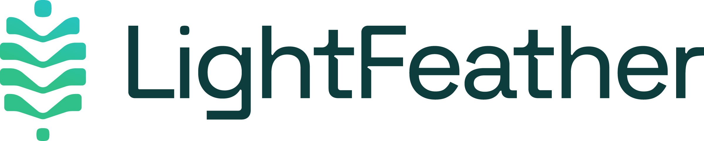

# DevOps Engineer Coding Challenge

## Rules of Submission

1. You can not have any commits after the scheduled live coding session. If any commits are found after this time period, your submission will be disqualified.
2. You can not run any AWS CLI commands after the scheduled live coding session. All API requests are monitored. Any requests made after the live coding session will result in your submission being disqualified.
3. Your submission must be in a private github repository that is shared with codingchallenge-eval@lightfeather.io

## Overview

This coding challenge is designed to assess the candidate’s familiarity with infrastructure concepts, infrastructure as code, automation, and documentation. You will be provided with a zip file that contains a frontend application and a backend application. This zip file will also contain skeleton code for a Jenkins pipeline and is missing the Terraform IaC code for the deployment.

You will need to create a free AWS account to complete the coding challenge. The challenge is designed to be completed using AWS Free Tier resources. All development should be completed in the us-east-1 AWS region.

## Requirements

You will need to create the necessary Terraform code to build your AWS infrastructure. This will require you to build your own VPC (one permitted) and associated resources. Please see the comments in `live/main.tf` for details on all requirements.

In addition to the terraform code to create your infrastructure, you will also need to save a plan file from your terraform code and upload it to your github repository. You may generate this file by performing the following commands inside the root of your terraform source:

```bash
terraform plan -no-color -out=plan.out
terraform show -json plan.out > plan.json
```

Please commit `plan.json` to the root of your repository.

You will need to build out the required Jenkins pipeline for building and deploying both applications. The files have already been provided with some code already filled in. You must create the additional code to finish the requirements.

_Note that you will not access a Jenkins server to test this code, so 100% accurate syntax will not count against you._

## README Requirements

In addition to how to run your solution, include a section titled Design decisions and production improvements covering:

- Trade-offs you made to stay within the AWS free tier (for example, subnet placement, task counts, NAT gateways)
- How you would scale this for production (autoscaling, redundancy across availability zones)
- Security hardening you would add with more time or budget
- Anything you would change or finish given more time

You are not expected to implement these. We evaluate your awareness of them.

## Explain Your Work

You may use AI assistants and any other resources. What we evaluate is whether you understand and own what you submit: you should be able to explain and change every part of it.

1. Commit as you go. We review your commit history, not just the final result. A single large commit at the end makes it hard to credit your work.
2. Add a section to your README titled Build log with 3 to 5 short entries in your own words. For each: what you were trying to do, what went wrong or what you had to decide, how you resolved it, and the commit where it happened. Keep it brief and specific; we will ask you about it.
3. If you advance, we will schedule a follow-up conversation in which you walk us through your solution, explain one design decision and an alternative you rejected, and make a small change to your code while sharing your screen.

## Submission Requirements

1. A private github repo that contains all the code in your solution. This repository must be shared with codingchallenge-eval@lightfeather.io for us to review it.
2. A README file in the github repo that provides any additional contextual information about your submission.
3. Your terraform plan JSON file uploaded to the root of your repository. Please see the previous section for details on how to generate this file.

## Evaluation

1. **Ability to understand the requirements**
   - **Completeness:** Are all requirements considered and addressed appropriately?
   - **Adaptability:** Can the solution be adapted to changing or evolving requirements?
2. **Demonstrating best practices and design paradigms with Infrastructure as Code**
   - **Modularity:** Is the code organized into reusable, modular components?
   - **Scalability:** Is the code designed to handle increasing demands or changing requirements?
   - **Security:** Does the code adhere to best practices for securing infrastructure?
3. **Clean Code**
   - **Readability:** Is the code easy to read and understand?
   - **Maintainability:** Is the code easy to modify or extend?
   - **Consistency:** Does the code adhere to a consistent style or pattern?
4. **Demonstrating best CICD practices**
   - **Automation:** Is the process fully automated, from code check-in to deployment?
   - **Continuous Deployment:** Is deployment automated and integrated into the process, with minimal manual intervention?
5. **Understanding and ownership**
   - **Explanation:** Can you explain the design, its trade-offs and the problems you solved?
   - **Change:** Can you modify your solution confidently when asked?

## Setup your environment

Install Node.js 24 (LTS). Binaries and installers can be found on nodejs.org. https://nodejs.org/en/download/

For macOS or Linux, Nodejs can usually be found in your preferred package manager. https://nodejs.org/en/download/package-manager/

Depending on the Linux distribution, the Node Package Manager npm may need to be installed separately.

The frontend and backend were last tested with Node.js 24 (LTS). The repository includes an `.nvmrc` file, so `nvm use` selects the right version.

Install Terraform. Binaries and installers can be found on HashiCorp’s website. https://learn.hashicorp.com/tutorials/terraform/install-cli

The instructions on HashiCorp’s website covers the installation steps for all major OS systems.

Install Docker. The most convenient Docker installer package is to use the Docker Desktop.

- https://docs.docker.com/desktop/install/windows-install/
- https://docs.docker.com/desktop/install/mac-install/
- https://docs.docker.com/desktop/install/ubuntu/

## Running the project

The backend and the frontend will need to run on separate processes. The backend should be started first.

```bash
cd backend
npm ci
npm start
```

The backend should respond to a GET request on `localhost:8080`.

With the backend started, the frontend can be started.

```bash
cd frontend
npm ci
npm start
```

The frontend can be accessed at `localhost:3000`. If the frontend successfully connects to the backend, a message saying "SUCCESS" followed by a guid should be displayed on the screen. If the connection fails, an error message will be displayed on the screen.

## Configuration

The frontend has a configuration file at `frontend/src/config.js` that defines the URL to call the backend. This URL is used on `frontend/src/App.jsx#12`, where the front end will make the GET call during the initial load of the page.

The backend has a configuration file at `backend/config.js` that defines the host that the frontend will be calling from. This URL is used in the `Access-Control-Allow-Origin` CORS header, read in `backend/index.js#14`

The frontend is a React app built with Vite. `npm start` runs Vite's development server on port 3000, and `npm run build` writes static files to `frontend/build`. Values the browser needs at build time must be named with a `VITE_` prefix and read with `import.meta.env` (Vite does not provide `process.env` in the browser).

<sub>Instructions v2.1 · October 2026</sub>
